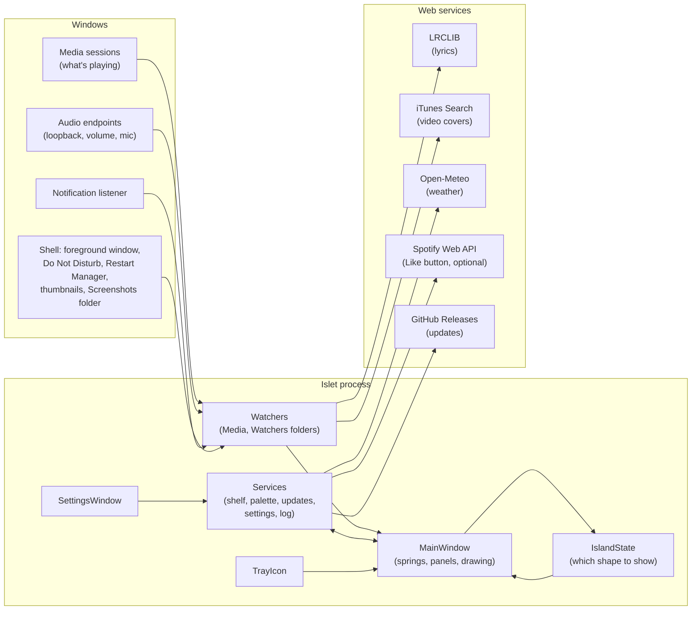

# Architecture

Islet is a single Windows desktop app: one always-on-top, click-through window that draws the island, plus a tray icon and a Settings window. It's written in C# with WPF on .NET 10, and has no server of its own.

## The big picture

Everything runs on the WPF UI thread except slow or blocking work (audio analysis, thumbnails, file-lock checks, network calls), which runs on background threads and hands results back to the UI thread.

## Source layout

| Folder | What's in it |
|---|---|
| `src/Islet/Island` | The island window. `MainWindow` is split into partial classes by feature (`.Dock`, `.Shelf`, `.Colors`, `.Locks`, `.Focus`, `.Timer`, `.Lyrics`, ...). `IslandState` decides the shape; `Spring` animates it. Also the drag backdrop and colour-picker windows. |
| `src/Islet/Media` | What's playing and how it looks: `MediaController` (Windows media sessions), `AudioVisualizer` (WASAPI loopback + FFT), `VolumeController`, `LyricsService`, `ArtworkService`, `AlbumPalette`, `SpotifyWebApi`. |
| `src/Islet/Watchers` | Things Islet notices: full-screen apps, notifications, mic and camera use, volume/brightness/devices, Windows Do Not Disturb. |
| `src/Islet/Services` | Plain logic with little or no UI: settings storage, the shelf and colour palette, file-lock lookups, thumbnails, updates and their signature check, the startup shortcut, the tray icon, logging, migration from the old MusicIsland name. |
| `src/Islet/Settings` | `AppSettings` (saved to JSON), the performance profiles, and the Settings window. |
| `src/Islet/Timer` | The countdown/focus timer and its dot-matrix views and Glyph alert. |
| `src/Islet.LegacyLauncher` | A tiny `MusicIsland.exe` shipped in releases so copies installed under the old name can update into Islet. |
| `tests/Islet.Tests` | xUnit tests. |
| `install.ps1`, `uninstall.ps1` | The one-line installer and uninstaller. |
| `tools` | Maintenance scripts, such as making the release signing key. |

## How the island works

1. **Watchers raise events** when something changes: a new song, a message, a volume change, a file dragged over, a full-screen app in front.
2. **`UpdateSurface` asks `IslandState.Choose`** which shape the island should take, given everything going on. `IslandState` is pure logic with no UI, so every rule (priority order, full-screen hiding, idle looks) is unit tested.
3. **Springs animate the change.** Width, height, opacity, scale and position are `Spring`s (response and damping, as in SwiftUI). Retargeting a spring keeps its velocity, so interrupted animations stay smooth.
4. **A frame loop runs only while something moves.** `OnRendering` steps the springs and redraws; when everything has settled it unhooks itself, so an idle island costs nothing. Continuous visuals (the bars, the spinning disc) run at the performance mode's frame rate.

Panels inside the island (the music card, shelf, colours, notifications) have fixed sizes and are revealed by the island's clip as it grows, rather than being laid out again every frame.

## State and storage

All state lives in `%AppData%\Islet`:

| File | Holds |
|---|---|
| `settings.json` | Every setting, including the Spotify Client ID and refresh token (encrypted with Windows DPAPI for your user account). |
| `timer.json` | A running timer, so it survives a restart. Removed when no timer is running. |
| `shelf.json` | Paths of files on the shelf (not copies). |
| `Shelf\` | Images and links dropped from web pages, saved as files. |
| `colors.json` | The last 12 picked colours. |
| `log.txt` | Errors and a few lifecycle events, rotated at 1 MB. Never message contents. |

The app itself is installed to `%LocalAppData%\Islet`.

## Updates

`UpdateService` checks GitHub Releases at launch and every 12 hours. A release is only offered if it carries a `.sig` file, and the downloaded zip is only installed if `ReleaseSignature` verifies that signature against the public key built into the app. See [SECURITY.md](../SECURITY.md) and [RELEASING.md](RELEASING.md).
